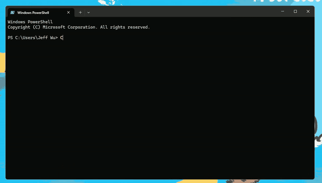

<p align="center">
  
</p>
<p align="center"><a href="assets/demo.mp4">▶ 高清视频 / Full-quality video</a></p>

# Claude Whiteboard

输入 `claude`，先看一段马克笔动画把终端涂成白板，再进入一个白板风格的 Claude Code 窗口。普通终端保持原样，退出 Claude Code 后白板窗口自动关闭。

## 一键安装（复制、粘贴、回车）

**Windows**：在 Windows Terminal 里粘贴这一行：

```powershell
irm https://raw.githubusercontent.com/wjunlin293-tech/claudecode-startup-animation/main/install.ps1 | iex
```

**Mac**（Terminal.app）：

```bash
curl -fsSL https://raw.githubusercontent.com/wjunlin293-tech/claudecode-startup-animation/main/install.sh | bash && exec zsh
```

装完 `cd` 到你的项目文件夹，输入 `claude`。就这样。当前窗口立刻能用（Mac 命令末尾的 `exec zsh` 就是让当前窗口加载新命令；如果你是分开运行的，装完请输入 `exec zsh` 或新开一个标签页）。

- 前提：Windows 10/11 + Windows Terminal（Windows 11 自带；Windows 10 在微软商店装一个），或者 Mac 自带的 Terminal；已经装了 Claude Code。
- **不需要** Node.js、git、Homebrew、管理员权限。动画用的运行环境会自动下载（约 100 MB，只下一次）并校验官方 SHA-256。
- 重复运行是安全的，改动前都会备份成 `.bak-时间`。
- 不想联网跑脚本？下载整个仓库的 zip，Windows 双击 `install.cmd`，Mac 运行 `bash mac/setup.sh`。
- 脚本做了什么：装字体 → 写入白板配色和“Claude Whiteboard”配置（只影响这个标签页）→ 下载动画 → 往 `$PROFILE` / `~/.zshrc` 加三行加载 `claude` 命令。全部源码都在这个仓库里。

## 日常使用

| 命令 | 效果 |
|---|---|
| `claude` | 播放动画，然后打开白板标签页（当前文件夹） |
| `claude-quick` | 不播动画，直接开白板标签页 |
| `claude-plain` | 在当前标签页运行，不换外观 |
| `claude-wb update` | 更新到最新版 |
| `claude-wb version` | 看版本，顺便检查有没有新版本 |
| `claude-wb doctor` | 自检；出问题先跑它，它会告诉你缺什么 |
| `claude-wb intro off` / `on` | 关 / 开启动画（赶时间的话可以永久关掉） |
| `claude-wb uninstall` | 卸载 |

动画播放时：**按 Esc，或点右上角的“跳过 Skip”**，立刻进入已经在后台启动的 Claude Code。拖动、缩放终端窗口，动画会跟着走。

第一次进入 Claude Code 后输入 `/theme`，选 **Whiteboard Marker**（Mac 版自动带上，不用选）。

## 更新

输入 `claude-wb update`，或者再运行一次上面的一键安装命令。你放的角色图和动画设置都会保留。

## 出问题了

1. 输入 `claude-wb doctor`，看红色的 `[FAIL]` 行，后面写着怎么办。
2. 解决不了：把 `claude-wb doctor` 的输出（或者安装时的报错原文）发给我，不要自己改一大段 JSON。

| 现象 | 处理 |
|---|---|
| 输入 `claude` 没反应 / 还是旧样子 | 新开一个标签页（旧标签页还是旧的命令） |
| 提示找不到 Claude Code | 先安装 Claude Code（官方文档 https://code.claude.com/docs ） |
| 装的时候下载失败 | 检查网络后重新运行同一行命令；没装上动画也不影响 `claude` 使用，补跑一次就有 |
| 框线还是直的 / 着色器报错、文字发虚 | 框线是直的是刻意的（用终端自带方块字符画吉祥物，更清晰）；文字发虚就用 `$env:CLAUDE_WB_NOSHADER=1` 再装一次（Windows） |
| 动画和窗口没对齐 | `claude-wb intro off` 先关掉动画，并把现象告诉我 |

## 换成你自己的角色图 / 调动画

- 把图片放进 `%USERPROFILE%\.whiteboard\characters\`（Mac：`~/.whiteboard/characters/`），一张就够；透明背景 PNG，512×512 左右。不用重新安装，下次 `claude` 就会用上。
- 动画参数（流动代码的透明度、速度、要不要画爱心）在 `~/.whiteboard/intro-config.json` 里改。

## 跳过更快 / 动画跟着窗口走（Windows）

- **提前启动**：动画一开始就在后台打开真正的 Claude Code 标签页，动画先用一张终端的静态截图盖住它，画到全白后再揭开。所以随时跳过，进入的都是已经在启动的 Claude。截图失败时自动退回旧做法。想关掉：在 `intro-config.json` 里加 `"earlyLaunch": false`。
- **跟随窗口**：动画播放期间拖动终端窗口，动画一起移动；改变窗口大小，动画按新尺寸重排，并从当前这一刻接着播。
- Mac 版同样会跟随窗口；但仍是动画退出后才开窗口（避免之前的“回车发不出去”问题），所以 Mac 上跳过后还要等一下。

## 平台说明

- **Windows**：本目录。需要 Windows Terminal 1.21 以上、Windows PowerShell 5.1。
- **Mac**（Terminal.app）：[`mac/`](mac/README.md)。尚未在真实 Mac 上完整验证。
- `HANDOFF.md`：交接说明，给你电脑上的 Claude Code 看。

## 以前的手动安装方式

一键安装之前的做法仍然可用：下载整个仓库，Windows 运行 `powershell -ExecutionPolicy Bypass -File .\setup.ps1`（可加 `-NoIntro`、`-NoShader`、`-Undo`），Mac 运行 `bash mac/setup.sh`。**不要再运行旧包里的 `claude-only.ps1`**，它会把 `claude` 命令改回没有动画的旧版本。

## 包里有什么

| 文件 | 作用 |
|---|---|
| `install.ps1` / `install.sh` | 一键安装 / 更新（网上直接运行） |
| `install.cmd` | Windows 下载 zip 后双击安装 |
| `setup.ps1` / `mac/setup.sh` | 真正干活的安装脚本，重复运行也安全 |
| `check.ps1` / `mac/check.sh` | 只读自检（`claude-wb doctor` 就是它） |
| `shell/` / `mac/shell/` | `claude`、`claude-wb` 等命令的定义 |
| `fonts/` `assets/` `claude/` | 手写风字体、白板背景和滤镜、Claude Code 主题和状态栏 |
| `intro/app/` | 启动动画程序（Electron） |
| `VERSION` | 版本号（`claude-wb version` 用它判断有没有新版本） |
